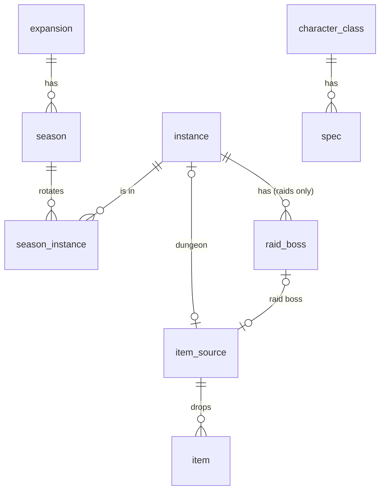

# Data model (PostgreSQL)

Status: draft · Last updated: 2026-10-09 · Part of the [backend migration plan](overview.md)

Full diagram with all columns: [diagrams/schema.mmd](diagrams/schema.mmd) (Mermaid). This document and the diagram are the source of truth until the Prisma schema and migrations exist.

## Game data

Key decision: **the loot table doesn't depend on the season.** An item belongs to a source (dungeon, or raid boss), and a season is just a rotation of instances. When an old dungeon comes back, you link the instance to the new season and all of its items show up. No item rows are duplicated.

| Table | Columns (main) |
| --- | --- |
| `expansion` | `id`, `code` (`MN`, `TWW`), `name`, `image_key`, `slim_image_key`, `sort_order`, `max_level` (character level cap, e.g. 90) |
| `season` | `id`, `code` (`MNS2`), `expansion_id`, `short_name`, `tier_name`, `image_key`, `starts_at`, `ends_at`, `is_current`, `status` (`ACTIVE` \| `FROZEN`) |
| `instance` | `id`, `code` (`FLOOD`, `TVA`), `type` (`DUNGEON` \| `RAID`), `name`, `short_name`, `blizzard_journal_id` (unique), `image_key`; unique (`id`, `type`) for the composite keys below |
| `season_instance` | `season_id`, `instance_id` (PK both) |
| `raid_boss` | `id`, `instance_id`, `instance_type` (always `RAID`), `code` (`ULGRAX`, unique), `name`, `blizzard_encounter_id` (unique), `sort_order`. (`instance_id`, `instance_type`) → `instance` (`id`, `type`), so a boss can only belong to a raid. |
| `item_source` | `id`, `type` (`DUNGEON` \| `RAID`), `instance_id?` (unique, dungeons), `raid_boss_id?` (unique, raids). One row per dungeon and per raid boss, created together with it. |
| `item` | `id` (= Blizzard item ID), `source_id` → `item_source`, `name`, `icon_key`, `slot`, `armor_type?`, `weapon_type?`, `offhand_type?`, `main_stats[]`, `secondary_stats[]`, `roles[]` (trinkets), `special_effect?`, `imported_from` (`PRE_RELEASE` \| `RETAIL` \| `MANUAL`), `source_payload jsonb` (raw import record as received, for debugging; never returned by public endpoints) |
| `character_class`, `spec` | replaces `globals/specs.ts`: `character_class.name` (unique); `spec.class_id`, `spec.name` (unique per class), `spec.role`, `spec.main_stat`, `spec.weapon_types[]`, `spec.offhand_types[]`; unique (`id`, `class_id`) for the composite keys below |

Codes (`season.code`, `instance.code`, `raid_boss.code`) are unique and act as stable natural keys: imports and change sets refer to rows by code, never by database ID.

Notes:
- **Exactly one current season.** A partial unique index on `season (is_current) WHERE is_current` allows only one row with `is_current = true`. A current season can't be `FROZEN`, and `ends_at > starts_at` (`CHECK`s). Several current seasons would only be needed for other game versions (Classic, Forever), which aren't planned; that would add a `game_version` column and make the index per version.
- **One drop source per item.** `item.source_id` is a single required column, so an item can't drop from a dungeon and a raid boss at the same time. If an item ever needs several sources, this becomes a link table again.
- **`item_source` is either a dungeon or a raid boss, never both.** A `CHECK` requires `instance_id` (and no `raid_boss_id`) when `type = 'DUNGEON'`, and the reverse when `type = 'RAID'`. The pair (`instance_id`, `type`) references `instance` (`id`, `type`), so a dungeon source can't point at a raid.
- The item variants (weapon / armor / trinket / misc / offhand) live in **one table with nullable columns plus `CHECK` constraints**. The API maps rows back to a discriminated union. That's simpler than one table per item type, and stronger: separate tables can't force an armor item to have its armor row without triggers. The rules (written with `IS NULL` / `num_nonnulls` so they never evaluate to NULL, which would let a row through):

  | Slot | `armor_type` | `weapon_type` | `offhand_type` |
  | --- | --- | --- | --- |
  | `HEAD`, `SHOULDER`, `CHEST`, `WRIST`, `HANDS`, `WAIST`, `LEGS`, `FEET` | required | null | null |
  | `MAINHAND`, `TWOHAND`, `RANGED` | null | required | null |
  | `OFFHAND` (shields and held items) | null | null | required |
  | `NECK`, `FINGER`, `BACK`, `TRINKET` | null | null | null |

  Further checks: `roles` is set exactly when the slot is `TRINKET`; the weapon type matches the slot (two-handed types such as `STAFF`, `POLEARM`, `AXE2H` only in `TWOHAND`; `BOW`, `CROSSBOW`, `GUN`, `WAND` only in `RANGED`; one-handed types in `MAINHAND`). Every one-handed weapon is stored as `MAINHAND`, even when it can also be equipped in the off hand. The frontend's "weapon" filter covers `MAINHAND` + `TWOHAND`, while `RANGED` has its own.
- List columns (`main_stats`, `secondary_stats`, `roles`, …) hold enum values. The API rejects duplicates and an empty `roles` list on trinkets when validating input; the database doesn't check this.
- Fixed game vocabulary (slots, stats, armor/weapon types, roles) stays as **Postgres enums**. It changes about once per expansion and drives UI logic. Content (seasons, instances, bosses) becomes **rows**. The test for which is which: if a new season needs it, it's a row.
- Display names and images for dungeons and bosses move into the DB. Today they live in frontend mappers.
- **Frozen seasons:** when a season ends, an admin sets it to `FROZEN`. Change sets that touch a frozen season (its rotation, or items that only drop in its instances) are rejected. Its data is then cached as immutable ([caching](api.md#caching--cold-starts)). An item that drops from an instance shared with an active season can still be edited.
- Fix while migrating: the old scraper output has `TWOHAND` and `EMiscType`, which the frontend doesn't. The DB becomes the single source of truth: its slot enum is the frontend's `EItemSlot` plus `TWOHAND`.

## Editorial / publishing

| Table | Purpose |
| --- | --- |
| `change_set` | A draft: `id`, `title`, `origin` (`IMPORT` \| `MANUAL`), `status` (`DRAFT` \| `PUBLISHED` \| `DISCARDED`), `base_version` (the `data_version` it was based on), `created_by`, `created_at`, `updated_at`, `resolved_by?`, `resolved_at?` |
| `change_set_entry` | One proposed change: `change_set_id`, `entity` (`item`, `item_source`, `season`, `season_instance`, …), `entity_key jsonb`, `op` (`CREATE` \| `UPDATE` \| `DELETE`), `before jsonb`, `after jsonb`; unique (`change_set_id`, `entity`, `entity_key`) |
| `data_version` | A single row (`CHECK (id = 1)`, created by the migration) holding a counter, bumped on every publish. Used as the API's `ETag` and cache key. |
| `audit_log` | `actor_id?`, `action`, `target`, `payload`, `created_at`. Append-only. |

**Base data + deltas.** Live tables hold the current published state (the base). Each change set is a delta: per row, its `before` and `after`. Published change sets, kept forever, are the history of every change. Reads never replay deltas; they only read the live tables, so public reads stay simple and fast.

Flow: an import (file upload or Blizzard API job, see [data-import.md](data-import.md)) or an editor's manual edit creates a change set → the admin UI shows a diff (new, changed and removed items) → an editor publishes → **all entries are applied in one transaction** → `data_version++` → audit entry written.

Rules:
- **`entity_key` uses natural keys**, not database IDs: `{"id": 268283}` for an item (its Blizzard ID), `{"code": "MNS2"}` for a season, `{"season": "MNS2", "instance": "FLOOD"}` for a `season_instance` row. That covers composite keys and rows that don't exist yet (a `CREATE` has no database ID). The unique constraint means a change set holds at most one entry per row: a second edit to the same row updates the existing entry instead of adding one.
- **Who changed the status:** `created_by` is always set. `resolved_by` and `resolved_at` are set exactly when the status leaves `DRAFT` (publish or discard), enforced by `CHECK`s. Every other status change (season frozen, role changed, wishlist archived, account deleted) writes an `audit_log` row; `actor_id` is NULL only for scheduled jobs.
- **Conflicts, like a git merge.** Publishing works like a fast-forward when `base_version` still equals `data_version`. Otherwise another change set was published in between, and each entry's `before` is compared with the current row. Matching entries apply as usual. A mismatching entry is a **conflict**: the publish is rejected and the admin UI shows the entry's `before`, the current row and its `after`. For each conflict the editor keeps their change (`before` is refreshed to the current row, `after` stays), drops the entry, or edits `after`. Then `base_version` is updated and the change set can be published. Bumping `data_version` in the publish transaction also serialises concurrent publishes.
- **Deleting an item that's on a wishlist is blocked** (`wishlist_item.item_id` has `ON DELETE RESTRICT`). The diff marks such entries with "on N wishlists", and publishing a change set that still contains one fails with that message, so the editor discards the entry first. User wishlists never lose items silently.
- `audit_log` is append-only: the app's database role has only `INSERT` and `SELECT` on it ([security](security.md#also-important)). Its `payload` holds no personal data, because the log outlives account deletion.

## Users (phase 3+)

| Table | Columns |
| --- | --- |
| `app_user` | `id`, `display_name`, `role` (`USER` \| `EDITOR` \| `ADMIN`), `created_at`, `deleted_at?`. Named `app_user` because `user` is reserved in Postgres. |
| `user_identity` | `id`, `user_id`, `provider` (`BNET` \| `DISCORD` \| `GOOGLE`), `provider_user_id`; unique (`provider`, `provider_user_id`); unique (`id`, `user_id`, `provider`) for the composite key below |
| `session` | server-side sessions (`id` = **hash** of the session token, `user_id`, `expires_at`). Revocable: a role change or "log out everywhere" takes effect immediately. |
| `character` | `id`, `user_id`, `identity_id`, `identity_provider` (always `BNET`), `region`, `bnet_character_id`, `realm_slug`, `name`, `level`, `class_id`, `active_spec_id?`, `last_synced_at`; unique (`region`, `bnet_character_id`); unique (`id`, `user_id`) |
| `wishlist` | `id`, `user_id`, `season_id`, `spec_id` (always set), `character_id?`, `name`, `archived_at?` |
| `wishlist_item` | `wishlist_id`, `item_id`, `added_at`, `obtained_at?` (PK `wishlist_id` + `item_id`) |

**Several identities per provider are allowed.** A user can link e.g. two separate Battle.net logins; each identity belongs to exactly one user (unique (`provider`, `provider_user_id`)). One Battle.net login already covers all WoW game accounts under it (WoW1, WoW2, …): the profile API returns characters from all of them in one sync.

**Character sync.** Battle.net tokens aren't stored ([security](security.md)), so a sync runs right after a Battle.net login, or from a "Sync characters" button that goes through Battle.net login again. The sync stores every character the profile API returns, with its level, and removes characters that no longer exist. The character list (`GET /api/me/characters`) shows only characters at the current expansion's `max_level`, so low-level alts stay hidden. They're filtered when read rather than skipped at sync time. That way a character that hits max level shows up after the next sync, and a new expansion raising the cap doesn't delete characters (and unlink their wishlists) before they've levelled. The filter applies only to that list: existing wishlists keep their linked character and show it whatever its level, so wishlists from earlier expansions stay intact.

**Characters are identified by Blizzard's character ID**, not by name: unique (`region`, `bnet_character_id`). A deleted and recreated character with the same name gets a new Blizzard ID, so it's a new row. A renamed or realm-transferred character keeps its ID, so the sync updates the existing row. A character belongs to one identity and one user. If a sync finds the character under another user (a character moved between Battle.net accounts), the sync moves it to the new owner in one transaction and first clears `character_id` on the old owner's wishlists.

Composite foreign keys keep related rows consistent (Postgres skips the check when any column in the pair is NULL):
- `character` (`active_spec_id`, `class_id`) → `spec` (`id`, `class_id`): a character's active spec belongs to its class.
- `character` (`identity_id`, `user_id`, `identity_provider`) → `user_identity` (`id`, `user_id`, `provider`): a character comes from a Battle.net identity of the same user.
- `wishlist` (`character_id`, `user_id`) → `character` (`id`, `user_id`): a wishlist always belongs to its `user_id` and can optionally link a character of the same user (users without Battle.net have none). The service still checks ownership; this is the backstop against IDOR.

Deletes:

| When this is deleted | Then | How |
| --- | --- | --- |
| `user_identity` (unlinked) | its characters are deleted | `ON DELETE CASCADE` |
| `character` (unlinked, or gone from a sync) | wishlists stay, without a character | `ON DELETE SET NULL (character_id)`: only that column, because `user_id` in the same key is required (Postgres 15+) |
| `wishlist` | its items are deleted | `ON DELETE CASCADE` |
| `item` on a wishlist | blocked | `ON DELETE RESTRICT`, see [publishing](#editorial--publishing) |
| `app_user` | never hard-deleted | see account deletion below |

**Account deletion** sets `deleted_at` and revokes sessions. After the 30-day grace period ([security](security.md#also-important)) a purge job deletes the user's identities (which deletes their characters), sessions and wishlists, and anonymises the row (`display_name` → "Deleted user"). The `app_user` row stays as a tombstone, so `change_set.created_by` / `resolved_by` and `audit_log.actor_id` keep pointing at a valid row.

Wishlists:
- A wishlist works like a shop wishlist: a flat set of marked items. There's no per-slot limit and no ranking. Several items for the same slot are fine, as is having none for a slot. `obtained_at` lets a user tick items off without deleting them.
- **Creating a wishlist is always a user action.** Syncing never creates wishlists. From the character list, "New wishlist" pre-fills the current season, the character's active spec and a suggested name. Users without Battle.net create wishlists without a character. A character can have any number of wishlists (e.g. separate raid, M+ and PvP sets).
- Wishlists are private: every query is scoped to `user_id = currentUser`.
- A wishlist is tied to one season (`season_id`), and users create new wishlists for new seasons. When a season ends, its wishlists get `archived_at` set and become read-only (still visible to the owner).
- Possible later, at a season change: an optional `purpose` (`RAID` \| `MPLUS` \| `PVP` \| `OTHER`) on `wishlist`, so BIS lists can be split by content type. Not planned for now.
- Email: Battle.net doesn't provide one. Don't store emails from Discord/Google unless a feature needs them (data minimisation, GDPR).

## Rules enforced by the API

These span several tables or depend on state, so constraints can't express them. Each one has a service check and an integration test ([testing](testing.md)).

- A wishlist item drops in an instance of the wishlist's season. If a season's rotation changes later, the diff flags wishlist items that are no longer in that season.
- A wishlist's `spec_id` belongs to the linked character's class.
- Frozen seasons and archived wishlists are read-only.
- Creating a dungeon or raid boss creates its `item_source` row in the same transaction.
- A character sync that moves a character to a new owner clears the old owner's wishlist links first.

## Implementing in Prisma

Prisma's schema can't express everything above. Create these migrations with `prisma migrate dev --create-only` and add the SQL by hand: `CHECK` constraints, the partial unique index on `season.is_current`, and `ON DELETE SET NULL (character_id)`. Cover each with an integration test that tries to write an invalid row. Map the user model to the table name with `@@map("app_user")`.

## BIS aggregation (later, not prioritised)

Nothing in earlier phases depends on this. The wishlist tables above already hold everything it needs.

A `bis_stat` table (or materialized view) holds (`season_id`, `spec_id`, `slot`, `item_id`, `user_count`, `share`). The slot comes from the item. It's refreshed by a GitHub Actions cron calling an authenticated endpoint. It reads only from active wishlists in the current season.

Rules:
- Count **distinct users**, not wishlists. Someone with three wishlists for the same spec counts once.
- Show a spec's BIS list only when **≥ N distinct users** have a wishlist for it. Start with **N = 20**, stored as a config value, and show the sample size ("based on 34 players").
- Below the threshold, show "not enough data yet" and optionally a raw "X players wishlisted this" count on items.
- With ~50 users spread over ~40 specs, expect most specs to stay under the threshold for a while.
- Since wishlists aren't "best in slot" picks (a fresh character may wishlist anything that fills a gap), weight the signal by share within the slot. Consider ignoring wishlists with very few items, or items marked `obtained`, when the time comes.
