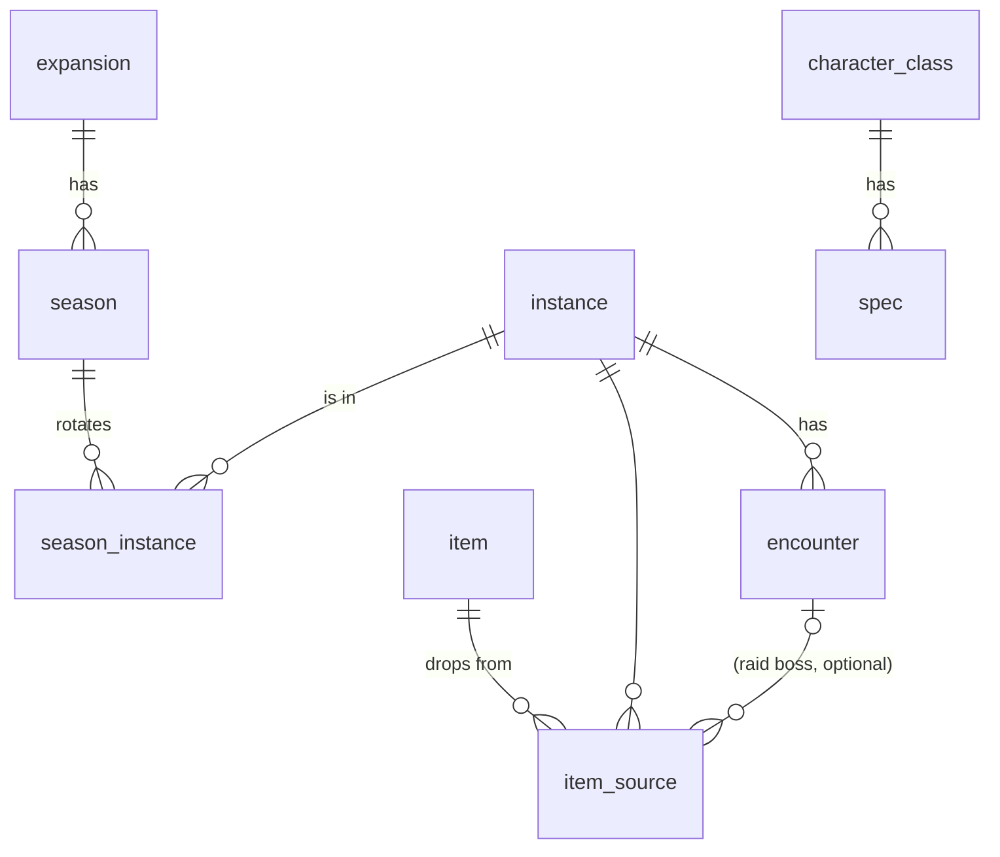

# Data model (PostgreSQL)

Status: draft · Last updated: 2026-10-08 · Part of the [backend migration plan](overview.md)

## Game data

Key decision: **the loot table doesn't depend on the season.** An item belongs to a source (dungeon, or raid boss), and a season is just a rotation of instances. When an old dungeon comes back, you link the instance to the new season and all of its items show up. No item rows are duplicated.

| Table | Columns (main) |
| --- | --- |
| `expansion` | `id`, `code` (`MN`, `TWW`), `name`, `image_key`, `slim_image_key`, `sort_order` |
| `season` | `id`, `code` (`MNS2`), `expansion_id`, `short_name`, `tier_name`, `image_key`, `starts_at`, `ends_at`, `is_current`, `status` (`ACTIVE` \| `FROZEN`) |
| `instance` | `id`, `code` (`FLOOD`, `TVA`), `type` (`DUNGEON` \| `RAID`), `name`, `short_name`, `blizzard_journal_id`, `image_key` |
| `season_instance` | `season_id`, `instance_id` (PK both) |
| `encounter` | `id`, `instance_id`, `code` (`ULGRAX`), `name`, `blizzard_encounter_id`, `sort_order` |
| `item` | `id` (= Blizzard item ID), `name`, `icon_key`, `slot`, `armor_type?`, `weapon_type?`, `offhand_type?`, `main_stats[]`, `secondary_stats[]`, `roles[]` (trinkets), `special_effect?`, `imported_from` (`PRE_RELEASE` \| `RETAIL` \| `MANUAL`), `source_payload jsonb` (raw import data, for debugging) |
| `item_source` | `item_id`, `instance_id`, `encounter_id?` (null for dungeons) |
| `character_class`, `spec` | replaces `globals/specs.ts`: `spec.role`, `spec.main_stat`, `spec.weapon_types[]`, `spec.offhand_types[]` |

Notes:
- The item variants (weapon / armor / trinket / misc / offhand) live in **one table with nullable columns plus `CHECK` constraints**, e.g. `armor_type IS NOT NULL` when the slot is an armor slot. The API maps rows back to a discriminated union. That's simpler than one table per item type, and only ~1k rows.
- Fixed game vocabulary (slots, stats, armor/weapon types, roles) stays as **Postgres enums**. It changes about once per expansion and drives UI logic. Content (seasons, instances, bosses) becomes **rows**. The test for which is which: if a new season needs it, it's a row.
- Display names and images for dungeons and bosses move into the DB. Today they live in frontend mappers.
- **Frozen seasons:** when a season ends, an admin sets it to `FROZEN`. Change sets that touch a frozen season (its rotation, or items that only drop in its instances) are rejected. Its data is then cached as immutable ([caching](api.md#caching--cold-starts)). An item that drops from an instance shared with an active season can still be edited.
- Fix while migrating: the old scraper output has `TWOHAND` and `EMiscType`, which the frontend doesn't. The DB becomes the single source of truth.

## Editorial / publishing

| Table | Purpose |
| --- | --- |
| `change_set` | A draft: `id`, `title`, `origin` (`IMPORT` \| `MANUAL`), `status` (`DRAFT` \| `PUBLISHED` \| `DISCARDED`), `created_by`, `published_by`, timestamps |
| `change_set_entry` | One proposed change: `entity` (`item`, `item_source`, `season`, …), `entity_id`, `op` (`CREATE` \| `UPDATE` \| `DELETE`), `before jsonb`, `after jsonb` |
| `data_version` | A single counter, bumped on every publish. Used as the API's `ETag` and cache key. |
| `audit_log` | `actor_id`, `action`, `target`, `payload`, `created_at`. Covers publishes, role changes, deletions. |

Flow: an import (file upload or Blizzard API job, see [data-import.md](data-import.md)) or an editor's manual edit creates a change set → the admin UI shows a diff (new, changed and removed items) → an editor publishes → **all entries are applied in one transaction** → `data_version++` → audit entry written. Live tables only ever hold published data, so public reads stay simple and fast.

## Users (phase 3+)

| Table | Columns |
| --- | --- |
| `user` | `id`, `display_name`, `role` (`USER` \| `EDITOR` \| `ADMIN`), `created_at`, `deleted_at?` |
| `user_identity` | `user_id`, `provider` (`BNET` \| `DISCORD` \| `GOOGLE`), `provider_user_id`, unique (`provider`, `provider_user_id`). One user can link several providers. |
| `session` | server-side sessions (id, user_id, expires_at). Revocable: a role change or "log out everywhere" takes effect immediately. |
| `character` | `id`, `user_id`, `region`, `realm_slug`, `name`, `class_id`, `active_spec_id`, `bnet_character_id`, `last_synced_at` |
| `wishlist` | `id`, `user_id`, `season_id`, `spec_id` (always set), `character_id?`, `name`, `archived_at?` |
| `wishlist_item` | `wishlist_id`, `item_id`, `added_at`, `obtained_at?` (PK `wishlist_id` + `item_id`) |

- A wishlist works like a shop wishlist: a flat set of marked items. There's no per-slot limit and no ranking. Several items for the same slot are fine, as is having none for a slot. `obtained_at` lets a user tick items off without deleting them.
- Wishlists are private: every query is scoped to `user_id = currentUser`.
- A wishlist is tied to one season. When a season ends, its wishlists get `archived_at` set and become read-only (still visible to the owner).
- Email: Battle.net doesn't provide one. Don't store emails from Discord/Google unless a feature needs them (data minimisation, GDPR).

## BIS aggregation (later, not prioritised)

Nothing in earlier phases depends on this. The wishlist tables above already hold everything it needs.

A `bis_stat` table (or materialized view) holds (`season_id`, `spec_id`, `slot`, `item_id`, `user_count`, `share`). The slot comes from the item. It's refreshed by a GitHub Actions cron calling an authenticated endpoint. It reads only from active wishlists in the current season.

Rules:
- Count **distinct users**, not wishlists. Someone with three wishlists for the same spec counts once.
- Show a spec's BIS list only when **≥ N distinct users** have a wishlist for it. Start with **N = 20**, stored as a config value, and show the sample size ("based on 34 players").
- Below the threshold, show "not enough data yet" and optionally a raw "X players wishlisted this" count on items.
- With ~50 users spread over ~40 specs, expect most specs to stay under the threshold for a while.
- Since wishlists aren't "best in slot" picks (a fresh character may wishlist anything that fills a gap), weight the signal by share within the slot. Consider ignoring wishlists with very few items, or items marked `obtained`, when the time comes.
